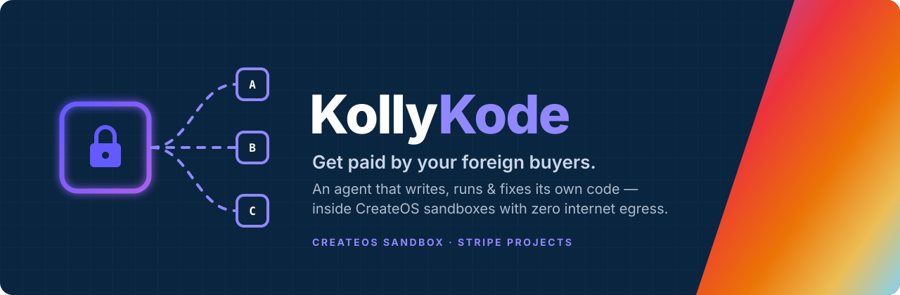

<p align="center">
  
</p>

<p align="center">
  <b>An AI agent that writes, runs and fixes its own Python inside locked-down CreateOS Sandboxes.</b><br>
  Upload a messy receivables ledger. Get a reconciled recovery plan and approved follow-ups — without your financial data ever touching the internet.
</p>

<p align="center">
  
  
  
  
  
  
</p>

<p align="center"><sub>Built solo for the CreateOS × Stripe Projects <i>"Build Agents That Run Code"</i> hackathon · 17 October 2026</sub></p>

---

## The problem

Small exporters and service businesses — a Nigerian agro-exporter, an agency or a software studio billing US, UK and EU clients — sell on 30–90 day terms, and too many of those invoices go late or silent. Collection agencies take a big cut, foreign lawyers cost more than the invoice, and accounting-tool reminders are generic.

Underneath it all, the ledger is a mess: mixed date formats, amounts typed as `£3,050` or `28,474 USD`, part-payments as separate rows, duplicates, blank due dates. Before anyone can chase money, someone has to understand the ledger — and that takes code, run somewhere the financial data can't leak.

## What KollyKode does

1. **Locks a CreateOS Sandbox down first.** The base sandbox is created with an egress allowlist of `127.0.0.1` only, then a real `curl` to the internet is run inside it to *prove* it's blocked before any data is uploaded.
2. **Writes, runs and fixes its own code.** The agent writes `clean.py`, runs it in the sandbox, and a fixed validator (written by us, not the agent) checks the output — including a **reconciliation check** that invoiced and paid totals per currency match an independent parse of the raw file, so the agent can't get the money wrong and still pass. Any traceback or failed check goes back to the LLM, which rewrites the script. First drafts come from a fast model; fixes escalate to a stronger one. Up to 4 attempts.
3. **Writes a strategy engine** (`strategy.py`) and tests it inside the base sandbox.
4. **Pauses and forks.** The base is snapshotted (paused) and forked into three branches — *Largest first*, *Oldest first*, *Most likely to pay*. Each fork is re-locked and re-verified, then all three run in parallel.
5. **Compares and drafts.** The agent picks a strategy with reasoning and drafts professional follow-up emails (no threats, no invented fees, no bank details).
6. **Pauses for a human.** The losing branches are destroyed; the winning fork is **paused** (compute billing stops) while the owner edits, unticks and approves the drafts.
7. **Resumes and publishes.** On approval the sandbox **resumes** exactly where it stopped, the agent writes `build_dashboard.py`, and the dashboard is served from the sandbox's **public live URL**.
8. **Audits everything** to Postgres (Neon, provisioned via Stripe Projects): every script version, error, fix, egress check and approval.

Nothing is ever sent automatically. KollyKode drafts; the owner decides.

## Sponsor tools

| Tool | How it's used |
|---|---|
| **Stripe Projects** | Provisions the stack from the CLI — `neon/postgres` (audit trail), `openrouter/api` (LLM) and `createos/project` — and syncs credentials into `.env` with `stripe projects env --pull`. |
| **CreateOS Sandbox** | Firecracker micro-VMs on the EU endpoint: create, run agent code, **egress allowlist + live verification**, **pause**, **fork ×3**, **resume**, and **ingress live URL**. |

## Run it

Requirements: Node.js 22+ (24 recommended), the Stripe CLI with the Projects plugin, a CreateOS account.

```bash
# 1. Provision the stack with Stripe Projects
stripe projects init kollykode --yes
stripe projects add neon/free --testmode=false --accept-tos --yes
stripe projects add neon/postgres --accept-tos --yes
stripe projects add openrouter/api --accept-tos --yes
stripe projects env --pull          # writes .env

# 2. Add the CreateOS key (and optionally a Groq key) to .env — see .env.example
#    CREATEOS_SANDBOX_BASE_URL must be https://api-eu.sb.createos.sh

# 3. Install, preflight, run
npm install
npm run check      # creates a sandbox, proves egress is blocked, pings the LLM, cleans up
npm start          # http://localhost:3000
```

Click **Use sample ledger → Run agent**. The sample in `sample-data/receivables.csv` is synthetic (40 invoices, 12 buyers, USD/GBP/EUR) and deliberately messy.

## Tech

- **Orchestrator:** Node.js (ESM), no framework — `src/server.mjs` serves the UI and streams agent events over SSE
- **Sandbox:** `@nodeops-createos/sandbox` SDK, `devbox:1` image (Python 3.13 + pandas preinstalled), `s-1vcpu-1gb`
- **Code the agent writes:** Python 3 + pandas, executed only inside the sandbox
- **LLM:** OpenAI-compatible API — OpenRouter (via Stripe Projects) or Groq
- **Database:** Postgres on Neon via Stripe Projects (falls back to `runs/audit.jsonl`)

```
src/
  server.mjs     web server + SSE
  pipeline.mjs   the case flow: base → clean → strategy → fork → compare → pause → resume → publish
  agent.mjs      write → run → validate → fix loop, plus the fixed validators
  sandbox.mjs    CreateOS lifecycle: create, egress lock + proof, pause, fork, resume, live URL
  prompts.mjs    what the agent is asked to write
  llm.mjs        OpenAI-compatible client with rate-limit retries
  audit.mjs      Postgres / JSONL audit trail
  check.mjs      preflight
public/index.html  single-page UI
```

## Privacy and safety

- All agent-written code runs in an isolated micro-VM with outbound internet blocked and verified.
- The LLM sees the column names and the first few raw rows (to write the cleaning code) and the ranked strategy summaries (to draft messages). The full ledger never leaves the sandbox.
- Human approval is required before any message is used. No autonomous sending, no legal advice.
- Secrets live only in `.env` (git-ignored).
